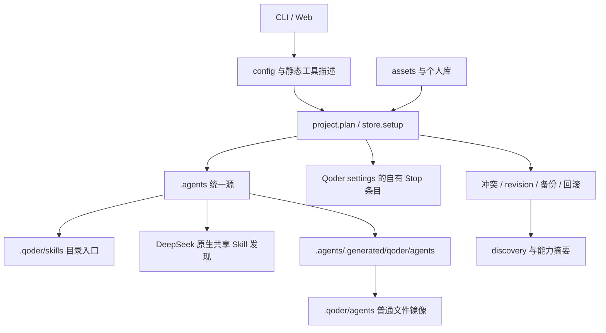
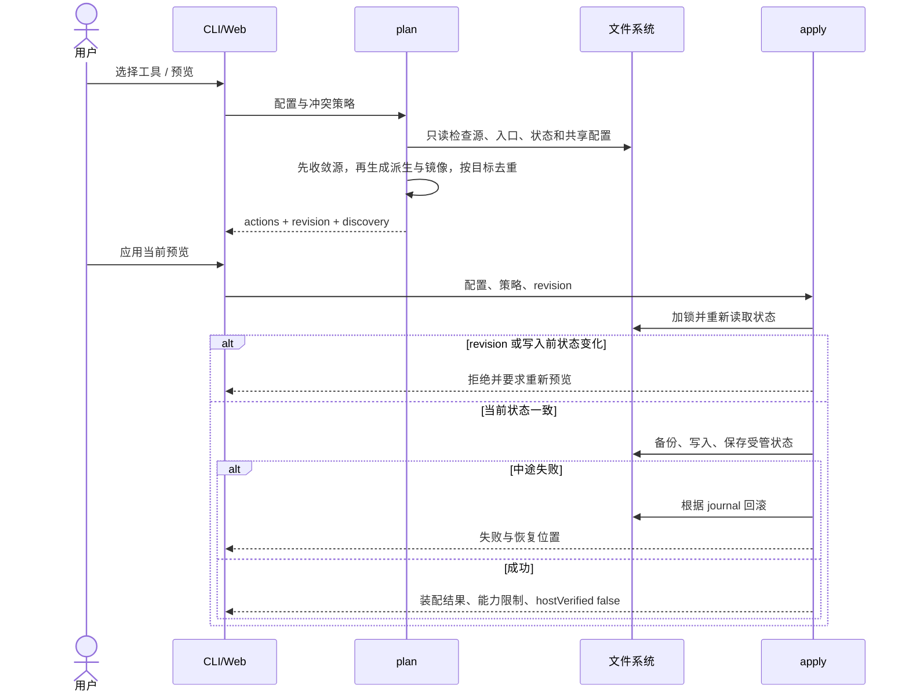

# Qoder 与 DeepSeek Harness 工程规范兼容技术方案

> Feature：990 | 状态：用户确认实施，开发中 | Profile：standard | 日期：2026-11-22
> 需求：[PRD](../spec/PRD.md) | 研究：[工程规范 gap](../context/ENGINEERING_GAP.md)
> 代码基线：my-ai-infra 0.0.15，`main@151cb1f0debf81eaa37df19268c30d2578e428c2`
> 模板：`mai-specs/_templates/TECH_DESIGN.tmpl.md`；项目未提供 FEATURE_LAYOUT 覆盖，沿用 Skill 默认布局。

[返回需求](../BRIEF.md) · [代码设计](CODE_DESIGN.md) · [HTML 审阅版](TECH_DESIGN.html)

## 1. 方案概述

### 1.1 目标与最小实现

在现有装配体系中新增 `qoder`、`qodercn`、`dsh`，复用 `.agents` 资产源、规则迁移、事务和冲突恢复。首批按 PRD 建议范围交付：Qoder CLI 的规则、Skill、命名角色和严格 JSON 配置下的格式化 Hook；DeepSeek 的规则、Skill 与准确的能力提示。

CLI 与 Web 均经过现有业务函数。新增一个纯静态工具描述模块，集中路径、入口形态和能力声明；其余变更落在既有装配模块。无新服务、数据库、配置版本和运行时依赖。既有五工具的路径、原生格式、调用方式及清理行为保持。

Qoder IDE、桌面、SDK 的完整兼容和 DeepSeek 插件注册作为后续切片。DeepSeek 默认及最新 alpha 的共享文件契约一致，宿主运行环境要求各自满足。

### 1.2 整体架构

规则通过根 `AGENTS.md` 链接读取；个人库 setup 的源位于用户 `.agents`，国际/CN 原生目录分别装配。图中的项目 `.qoder` 同时服务两个 Qoder CLI。

### 1.3 关键决策与 Review 索引

| 决策 | 推荐与原因 | 代价、备选与退出条件 | 审阅入口 |
|---|---|---|---|
| D-01 保留中立资产源 | 共用 `.agents` 与现有工作流 | 宿主格式继续由适配层维护；避免重复维护工作流内容 | §2.1 |
| D-02 静态描述集中入口 | 当前三种 Skill 形态及能力差异已有明确使用点 | 旧常量派生输出保持 API；逐文件补映射容易遗漏全局/清理分支；不引入可加载插件框架 | 代码设计 §1 |
| D-03 Qoder 角色用普通镜像 | 发布包角色枚举跳过文件软链 | 增加镜像同步与冲突语义；若宿主未来支持软链，可经迁移改回入口链接 | §2.3.2、代码设计 §3 |
| D-04 按物理目标去重 | Qoder 双端共用项目目录，DeepSeek 与 Codex 共用源 | 只合并相同语义、相同内容的输出；不同输出仍报错 | 代码设计 §2 |
| D-05 新工具只撤回受管文件 | 升级旧项目时应保留已有用户宿主目录 | 静态表记录 legacy-directory / managed-files 两种现有兼容边界；全仓清理模型统一另行设计 | §2.3.3 |
| D-06 JSONC 先保留并报告 | 当前无运行时依赖，现有 JSON 合并器覆盖严格 JSON | 含注释配置需手工在宿主注册或整理；若该限制阻碍常见使用，再独立评审保留注释的编辑实现 | §2.3.4 |
| D-07 DeepSeek 分阶段 | Preset、允许委派列表、Hook 生命周期需要原生注册 | 首批缺命名角色与自动格式化；后续插件切片需实际宿主验证后定接口 | §2.5 |

2026-11-23 用户确认按第二方案实施。实现复用既有事务与冲突机制；真实宿主测试结果可触发入口选择调整。

## 2. 详细设计

### 2.1 数据结构与路径

新增 `src/tool-adapters.mjs`，声明 `label / aliases / family / roots / skills / agents / cleanup`（ID 为表键）。保留并从该表派生 `TOOLS`、`GLOBAL_TOOLS`、`AGENT_TOOLS`、`GLOBAL_AGENT_TOOLS`、`AGENT_FORMATS`，规则正文和 Hook 合并逻辑继续属于各自模块，避免循环依赖。表内使用相对路径，不读取文件系统或宿主设置。

| ID | 项目 Skill / 形态 | 用户 Skill / 形态 | 项目角色 | 用户角色 | 清理策略 |
|---|---|---|---|---|---|
| qoder | `.qoder/skills` / directory | `.qoder/skills` / directory | `.qoder/agents/*.md` 普通镜像 | `.qoder/agents/*.md` 普通镜像 | managed-files |
| qodercn | `.qoder/skills` / directory | `.qoder-cn/skills` / directory | 与 qoder 共用 | `.qoder-cn/agents/*.md` 普通镜像 | managed-files |
| dsh | `.agents/skills` / source | `.agents/skills` / source | unsupported | unsupported | managed-files |

既有 Skill：Codex 为 source、MiniMax 为 directory、其他为 files。既有 Agent：MiniMax 项目为 unsupported、用户为普通文件，其他按现有链接形式。Qoder 的 renderer family 为 `qoder`，派生目录共用 `.agents/.generated/qoder/agents`。国际/CN 用户角色目录深度相同，指向共享 Skill 的相对路径相同，可共享派生文本。

期望图仍用现有 `Map<relativePath, output>`：`file` 有 text，`symlink` 有 target/source；`requires` 表示依赖。新增镜像只扩展计划内的依赖/期望内容，无需持久化新的文件类型。state 沿用 v4 的普通文件 hash；`global-state.json` 沿用每路径 digest。配置继续为 version 1，只增加可选 tools 枚举。

同目标重复计划须同时满足 kind、text/target、source、requires、expectedText 等语义字段一致；不同来源即使字节相同，也要求先由调用方收敛到同一规范来源，不能静默吞掉资产冲突。通用 `addFile/addLink` 的严格重复检查可保持，新增收集层在调用前完成已知同族去重，具体代码见附录。

### 2.2 数据流与事务

继续使用现有锁、inspect/snapshot、备份 journal 和回滚；镜像及宿主设置加入同一计划，无独立写文件旁路。全局 setup 保持现有锁与一次性冲突预检；冲突时整体退出，保留先前安装。全局 setup 不新增“取消勾选即卸载”行为。

### 2.3 分模块设计

#### 2.3.1 Skill、规则与全局装配

`project.plan()` 先写一次 `SKILL_SOURCE`，随后遍历选中工具声明：source 跳过别名；directory 每 Skill 建一个目录软链并依赖源 `SKILL.md`；files 继续逐文件链接。移除以 `new Set(['codex', ...tools])` 表示中立源的隐含绑定，使用现有 `SKILL_SOURCE` 常量。

`store.setup()` 复用同样入口策略，维持 `globalSkills` 当前选择算法。调用角色 renderer 前检查用户角色能力，DeepSeek 跳过原生入口；共享角色源可按既有选择规则留存。工具清单的两个 Qoder ID 可同时输出两个用户原生目录；源与同族派生内容只写一次。所有产物继续接受 pathInspector 的外部链接边界检查。

`rules.mjs` 的根 `AGENTS.md` 绑定增加三个 ID，继续使用 `.agents/rules/AGENTS.md`。不批量复制规则到 `.qoder/rules`，避免额外优先级和重复正文；已有用户专属规则保留。DeepSeek 同时读取 CLAUDE.md 时，已有共享链接继续保留，独立正文继续按宿主语义加载。任意 `.agents/rules/*.md` 的自动发现不在承诺中。

#### 2.3.2 Qoder 角色普通文件镜像

在 `agents.mjs` 添加 Qoder renderer：`name`、`description`、`model: inherit`、`skills` 加正文。中立源的 `{{SKILL:...}}` 按原生目标文件位置解析到共享 Skill。`skills` 仅包含已选角色依赖，保持现有角色筛选条件。

装配顺序为“解析并收敛中立源 → 渲染最终候选 → 规划派生文件 → 规划原生普通文件”。中立源采用既有 merge/replace/abort 决议后的有效内容；冲突或解析失败时显示具体路径，整个角色链不得显示 ready。

| 当前文件状态 | 默认 merge | replace | abort |
|---|---|---|---|
| 缺失 | 创建普通镜像 | 创建 | 创建 |
| 与候选一致 | noop，补齐/保持记录 | noop | noop |
| 与上次受管 hash 一致 | 更新为新候选 | 更新 | 更新 |
| 用户编辑或未知同名文件 | 保留并保存候选，待同步 | 先备份再替换 | 冲突，保持现场 |
| 路径存在外部链接或不可写边界 | 保留并阻断写入 | 同左 | 同左 |

派生文件和原生镜像都设置 `expectedText`；镜像 `requires` 指向同族派生，派生依赖中立源。discovery 除既有依赖判断外确认最终内容等于候选，并汇总角色所引用 Skill 的就绪状态，避免保留旧镜像或缺失依赖后仍显示 ready。原生普通文件属于派生物，文档指引将定制合入 `.agents/agents`；安装器不反向推导中立角色正文。

需在现有 managed-state 校验中接受新生成路径和原生普通文件。检查 `isManagedAgentPath`、`derivedAgent` 及 state 文件类型验证，不通过放宽任意路径来适配。代码设计 §3 展开关键分类。

#### 2.3.3 去重、清理与升级

项目期望图由当前完整选择构建。先按物理路径收敛，再计算旧受管条目中已不需要的集合。只取消 qoder 或 qodercn 时，共享路径仍在期望图中，角色、Skill、Hook 保留；两者都取消才撤回对应受管条目。

当前 `cleanupTools` 将所有未选工具目录整体归档。新工具采用 managed-files：不得把 `.qoder`、`.qoder-cn`、`.dsh` 放入整体 cleanupDirectories，`retiredPrompts` 的根扫描也使用同一策略过滤。旧五工具的 legacy-directory 策略保持原样。实现中 cleanup 直接记录可整体归档的目录数组；新工具为空数组，逐文件撤回沿用旧 state，无需额外策略枚举。新增工具枚举后，即使项目已有有效旧 state，也不触碰未受管的 Qoder/DeepSeek 目录。

需要撤回的文件按旧 state 的路径、形态与 hash 校验；用户改动继续进入现有冲突/恢复策略。没有受管记录的文件保留，空父目录可保留。共享 `.agents` 目录按所选资产集合管理，不按 dsh 目录整体撤回。

Qoder settings 属于共享文件，撤回交给 formatHookActions 的语义处理；通用删除分支排除这一条目，避免删除整份配置。有效记录只允许既有自有 Hook 形态。全局 setup 维持保留既有工具策略，不做目录清理。

#### 2.3.4 格式化 Hook 与扩展

给 `FORMAT_CONFIGS` 增加 Qoder family：项目 `.qoder/settings.json`，事件 `Stop`，grouped 为 true，timeout 30 秒。处理循环改为按配置 path 分组，active 为组内任一工具选中且启用了格式化；一次生成 action，两工具各映射同一个 registration。只保留一条带现有 marker 的命令。

复用现有 format 检测、`.agents/hooks/my-format/run.mjs` 与 shell quoting。保持其他事件、其他 handler、settings 字段和用户 Hook 开关。无项目格式化配置时按既有行为不注册；有配置但无 format/fmt 脚本时沿用运行时跳过及诊断。

严格 JSON 可以结构化更新。注释 JSON、结构异常、用户修改自有 handler 或外部链接路径生成配置冲突，保留全文。merge/replace 均不把不可解析共享配置整体替换为框架模板。用户处理配置或通过宿主手工注册后再验证。注册成功也须提示宿主信任、权限、禁用设置和 Stop 事件尚待真实会话验证。

`assets.mjs`、内置 format 的 asset.json、manifest 与校验脚本增加新工具允许路径。Qoder 扩展使用 `.qoder/<type>/<name>/...`，CN 用户级对应 `.qoder-cn`；DeepSeek 可装配 `.dsh/<type>/<name>/...` 的独立资源。继续拒绝扩展覆盖整份 `settings.json`、`cordis.yml` 或 `.mcp.json` 等共享注册配置。扩展装配仍提示宿主注册，DSH 的 format 内置资产本期不声明自动注册入口。

#### 2.3.5 discovery、CLI 与 Web

`discovery.mjs` 从描述表取得 Skill 入口、角色能力和调用提示。MiniMax 的“用户级 setup”提示保留；DeepSeek 命名角色给出“当前适配器暂未接入 Preset 注册”，无需生成空路径或错误的 setup 建议。

现有 `planned / ready / needs-sync / configuration-required / unsupported` 与 `hostVerified:false` 保持。DeepSeek 自动格式化能力摘要始终可见，即使项目当前没有安装 format 资产；资产列表继续只列实际资产。能力缺失与用户需配置分开描述，未来完成注册再切换。

`CLI aliases / help / labels` 新增 qoder、qodercn（可接受 qoder-cn 别名）、dsh（deepseek-harness 别名）；配置中保存 canonical ID。Web 工具选择区复用现有组件，预览/应用结果增加 PRD 指定的简短能力摘要。Web 所需标签与能力从既有目录响应中增补可选元数据；保留原有字段，避免引入独立业务逻辑或改变 API 路由。

`doctor` 保持只读，输出是装配检查；文档提供宿主发现核验步骤。默认路径被环境变量或宿主配置改写时，安装器不自动改动这些设置；明确显示默认路径限制。

### 2.4 配置与接口影响

| 项目 | 变化与生效 |
|---|---|
| 项目 config / defaults | version 1 的 tools 增加三个 ID；`skills`、`projectId` 不变，默认 codex 不变 |
| 受管 state | 维持 v4、global digest 格式；扩展合法工具路径与普通镜像形态，旧 state 继续读取 |
| plan / doctor | 原结构保留；discovery 增加新工具条目，必要的能力摘要元数据为增量字段 |
| Web API | 沿用预览/应用与 catalog 入口；当前 revision 和 token 校验不变 |
| 宿主 settings | 仅 Qoder 项目格式化注册；用户级 setup 不自动注册 Hook |
| 自定义宿主路径 | 首批使用默认目录；QODER/QODERCN_CONFIG_DIR、DSH_HOME、DSH_AGENTS_HOME 或 provider 自定义由用户配置 |
| npm / Node | 不新增运行时依赖；mai Node 22+；宿主 engines 以版本快照为准 |

旧版本 mai 读取含新 ID 的配置会拒绝未知工具。回退时使用升级前备份，或先在新版本取消新工具后再降级；不让旧版本操作未知 state 路径。实际版本号及发布流程在实现验收后按发布指南确定，本轮不修改版本。

### 2.5 DeepSeek 后续完整接入路径

本期保留命名角色中立资产和手工工作流调用路径，主会话可执行对应 Skill；命名委派、独立上下文和角色工具权限不承诺等价。后续单独创建插件切片，至少覆盖：

1. 将中立角色转换成受管 Agent Preset 配置，注册插件实例及 id，校验冲突。
2. 在父代理 subagent 的 allowedAgentPresets 中注册，验证 spawn backend、Skill 及工具权限。
3. 使用宿主原生 Stop 生命周期和会话工作区 cwd；同一进程切换项目时使用正确的格式化命令。
4. 对 Cordis 配置执行最小范围合并和撤回；重启/热更新条件、插件版本及权限由真实宿主验收确定。

触发条件为用户需要 DeepSeek 的命名评审角色或自动格式化闭环，并具备可运行的宿主验证环境。未完成这些条件前不生成宣称已生效的插件配置。

## 3. 风险与最小验证

| 风险及触发 | 处理与验证 |
|---|---|
| Qoder 同时发现共享与原生同名 Skill | 目录入口指向同源；真实 CLI 核对去重、来源与资源解析；如出现重复且无法消除，收敛为经过验证的单入口策略后再验收 |
| 角色普通镜像被手工编辑或生成源变化 | 源先收敛；镜像 hash/期望内容校验；组合冲突策略与失败回滚集成测试 |
| 升级使未选新工具参与目录清理 | 新工具受管文件策略，同时过滤 retired 根扫描；含用户目录的旧 state 夹具验收 |
| Qoder 注释配置阻止自动格式化 | 保留全文、明确恢复提示；不声称所有合法 Qoder 配置都可自动修改 |
| 宿主默认发现关闭、私有同名 Skill 遮蔽 | 文档列开关与优先级；真实宿主查看路径；不自动覆盖用户设置 |
| DeepSeek alpha 的 Node 与接口快速变动 | 默认通道和 alpha 分开验证，实施前刷新版本；当前源码结论保留固定快照 |
| 非 Git cwd、子模块、工作树根不同 | 在隔离多层目录核对规则和 Skill 根；支持说明记录真实发现范围 |

## 4. 兼容性与交付门槛

| 对象 | 研究结论 / 目标 | 实施验收 |
|---|---|---|
| 现有五工具与旧 state | 保持现有契约 | 完整回归及旧版本夹具 |
| Qoder CLI 国际/CN 1.1.95 | 默认路径具备接入依据 | 真实角色列表、Skill 调用、共享同名来源、Stop 与撤回 |
| Qoder IDE 1.41.1 / Desktop 0.5.17 | 文档能力分别记录 | 独立验收后扩展支持声明 |
| DeepSeek 0.2.2-rc.5 | 规则与 Skill 原生发现 | 根软链、显式调用、资源、优先级、普通工作流 |
| DeepSeek 0.2.3-alpha.2 | 文件契约源码一致 | 满足 engines 的环境执行同组验收；结果单独记录 |

实施前补齐 FR/AC 对应测试材料，尤其是共享目标去重、普通镜像冲突、升级误清理、JSONC 和 DeepSeek 部分能力。按项目要求完成 `npm run verify`、`npm run test:web`、`npm run release:check`；宿主验收在隔离项目/测试 HOME 执行，不修改真实个人配置。文件装配、宿主发现、宿主调用分别记录。

2026-11-23 实现与自动化自检完成，详细覆盖及保留门槛见 [实施记录](../dev/IMPLEMENTATION.md)。Qoder 发布包枚举及默认开关曾做隔离检查，认证宿主会话尚未执行。

## 5. 文件级任务分解

| 任务 | 文件与职责 | 前置 | 完成条件 / AC |
|---|---|---|---|
| T-01 描述表与能力清单 | 新增 `src/tool-adapters.mjs`；修改 store/agents/discovery 的派生常量，CLI 与 Web 标签来源 | 方案评审 | 八工具配置与默认兼容；AC-01、12 |
| T-02 共享 Skill 与规则 | `src/project.mjs`、`src/store.mjs`、`src/rules.mjs`、`src/assets.mjs` | T-01 | 项目/全局 source、directory、files；组合去重；AC-02、03、10 |
| T-03 Qoder 角色 | `src/agents.mjs`、project/store、state 路径验证 | T-02 | 普通镜像、同族派生、冲突与诊断；AC-04、05 |
| T-04 撤回与扩展边界 | project/assets/retired-prompts 调用点、format 共享配置排除 | T-01、02 | 新工具只处理受管条目，旧目录和共享目标保留；AC-03、06、12 |
| T-05 格式化 | `src/format-hook.mjs`、`assets/hooks/my-format/asset.json`、manifest | T-04 | path 分组、Stop/30 秒、JSONC 冲突和撤回；AC-07、08 |
| T-06 CLI/Web 能力反馈 | discovery/cli/web，复用现有 API 与 UI | T-02～05 | DeepSeek 限制、成功/冲突文案、默认路径提示；AC-01、09 |
| T-07 回归与宿主验证 | `test/`、`scripts/check-web.mjs`、`scripts/release-check.mjs`、校验工具枚举 | T-06 | AC-01～12；真实 CLI 与 DeepSeek 版本分组记录 |
| T-08 文档与分发 | README、usage、custom-agents、troubleshooting、assets/README、manifest、包说明 | T-07 | 版本/能力/限制准确；verify、浏览器及分发验收通过后提交发布候选 |

T-01～T-06 的实现已完成，T-07 自动化部分与 T-08 文档/安装包检查通过。T-07 的认证宿主验证仍待执行；2026-11-23 自检时未提交或发布，2026-11-25 已获 patch beta 发布授权。DeepSeek 原生插件保持独立后续范围。

## 6. 实施收敛（2026-11-23）

- 复用同一 `addSkillEntries` 和 `addAgentEntries` 供项目与全局装配调用；共享目标由 `collectTarget` 校验，独立扩展仍维持严格冲突。
- 静态表的 roots 统一扩展路径边界，cleanup 使用原有目录数组，空数组表示新工具只撤回受管条目。
- 普通镜像分类直接复用 `project.plan` 与 `resolveConflicts`，以计划内 mirror/expectedText/requires 标记扩展；未新增持久化状态版本或独立冲突执行器。
- 角色汇总检查依赖 Skill；保留不一致镜像时 complete 为 false，doctor 不报健康。setup 增加区分全局范围的能力摘要。
- 共享 Qoder Hook 按物理配置路径分组；其他宿主维持原事件与超时。
