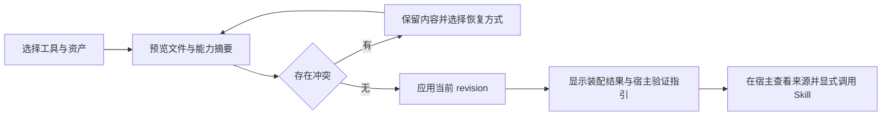

# PRD：Qoder 与 DeepSeek Harness 工程规范兼容

> 状态：首批范围已由用户确认，实施中 | Profile：standard | 日期：2026-11-22
> 模板：`mai-specs/_templates/PRD.tmpl.md`，按本次接入裁剪。

[返回需求简报](../BRIEF.md) · [差异研究](../context/ENGINEERING_GAP.md)

## 1. 背景与目标

my-ai-infra 0.0.15 已通过 `.agents` 统一管理五款工具的工程资产。用户希望使用阿里 Qoder 和 DeepSeek Harness 时继续沿用相同的规则、Skill、角色和 SDD 工作流。当前工具枚举、入口文件形态、全局安装、目录撤回及诊断存在差异，直接添加目录映射会带来重复目标、角色无法发现和误清理风险。

2026-11-22 完成需求、版本研究与技术方案，2026-11-23 用户确认按第二方案实施。本文定义实现范围与验收条件，实际执行结果见实施记录。研究基线为 Qoder CLI 国际/CN 1.1.95、DeepSeek 默认 0.2.2-rc.5 与最新 alpha 0.2.3-alpha.2；IDE 和桌面应用单列能力边界。

目标是保留 `.agents` 唯一项目源，让 CLI 与 Web 可选择两款宿主，明确哪些资产已经装配、哪些能力需要宿主配置或后续开发。首批建议 Qoder CLI 接入规则、Skill、角色与格式化 Hook，DeepSeek 接入规则与 Skill。

## 2. 用户与场景

| 用户故事 | 场景 | 目标 | 需求 |
|---|---|---|---|
| US-01 | 在现有项目增加 Qoder 或 DeepSeek | 继续使用已有规则和工作流，保留项目定制 | FR-01～03、FR-06 |
| US-02 | 同时使用 Codex、Qoder 国际/CN、DeepSeek | 共享 Skill，避免重复注册和相互撤回 | FR-02、FR-06 |
| US-03 | 使用 Qoder 进行架构/代码评审 | 能找到选中 Skill 对应的角色，结束后按项目配置格式化 | FR-04 |
| US-04 | 排查 DeepSeek 工程流程 | 看清角色、Hook 的当前支持范围及 Skill 调用方法 | FR-05、FR-07 |

## 3. 总体业务流程



原有项目同步、个人库 setup、doctor 入口继续使用。只有应用和 setup 写入，预览及 doctor 保持只读。

## 4. 功能需求

### 4.1 新增需求

| 编号 | 触发与输入 | 预期行为 | 可观察结果 |
|---|---|---|---|
| FR-01 | CLI/Web 选择工具 | 增加 `qoder`、`qodercn`、`dsh`；国际/CN 可同时选 | 配置保存、回显和预览均识别新 ID |
| FR-02 | 装配项目或执行全局 setup | `.agents/skills` 保持普通源；Qoder 增加原生目录入口，DeepSeek 直接使用源；同物理目标只装配一次 | Skill 正文和附属资源完整，重复 setup 幂等 |
| FR-03 | 任一新工具首次安装或同步 | 复用根 `AGENTS.md` 及现有规则迁移；保留独立规则、用户链接与定制 | 根规则可读，规则正文仍由项目维护 |
| FR-04 | Qoder 选择了角色依赖 Skill，或项目有格式化配置 | 生成可被枚举的普通角色文件；严格 JSON 配置下合并一条主会话 Stop Hook | 国际/CN 的项目角色及 Hook 共用，用户级角色目录分别装配 |
| FR-05 | DeepSeek 预览、应用或 doctor | 显示规则/Skill 基础支持；命名角色、自动 Hook 显示本适配器暂未接入；保留手工调用工作流路径 | 不生成无效角色入口，不提示通过 setup 即可解决命名角色 |
| FR-07 | 查看工具选项和装配结果 | 显示简短能力范围、调用/刷新方式、宿主发现尚待验证；普通 CLI 与 SDK/IDE/桌面范围清楚 | 用户能决定该工具是否满足当前工作流 |
| FR-08 | 发布兼容说明 | 固定研究版本和通道，列出默认路径、自定义路径限制、MCP 注册边界、真实宿主验证结果 | 文档可按具体版本复核，未验证表面不写成全面支持 |

### 4.2 变更需求

| 编号 | 触发与输入 | 预期行为 | 可观察结果 |
|---|---|---|---|
| FR-06 | 组合选择、升级、取消工具或本地修改 | 新工具按受管文件撤回；保留用户宿主目录和共享目标；源/派生/镜像受 revision、冲突、备份及回滚保护 | 单端取消不影响另一端；冲突保留时显示待同步；旧五工具行为保持 |

## 5. UI 视觉与交互

沿用现有工具选择区和预览区，复用项目设计系统。本次线框为拟议局部修改；实际浏览器布局在实现阶段验收。

```text
选择工具
[ ] Qoder CLI       规则、Skill、角色、自动格式化
[ ] Qoder CLI CN    规则、Skill、角色、自动格式化
[ ] DeepSeek Harness    规则、Skill

装配预览
文件变更（沿用现有列表）
工具能力
Qoder CLI：角色使用受管普通文件；格式化遵循宿主设置。
DeepSeek Harness：已提供规则与 Skill 入口；命名角色和自动格式化暂未接入。
宿主发现：待验证
[应用当前预览]
```

选项默认保持项目已选工具；新安装默认仍为 Codex。空态、加载、revision 过期和应用按钮继续沿用现有行为。存在配置冲突时定位到现有冲突行，处理后重新预览。能力限制持续展示，操作成功后也保留。

| 文案 ID | 位置/状态 | 最终文案 |
|---|---|---|
| COPY-01 | DeepSeek 选项说明 | 支持规则与 Skill；命名角色、自动格式化暂未接入。 |
| COPY-02 | 装配成功提示的补充 | 文件装配完成，宿主发现待验证。 |
| COPY-03 | Qoder 含注释配置 | 当前配置含注释或无法解析，已保留原文件。请使用宿主设置注册格式化 Hook，或将配置整理为有效 JSON 后重新预览。 |
| COPY-04 | Qoder 角色镜像冲突 | 角色入口有本地修改；merge 将保留内容并保存候选，请将定制合入中立角色源后重新同步。 |
| COPY-05 | 默认路径限制 | 当前按宿主默认目录装配；使用自定义目录或关闭默认发现时，请在宿主核对实际来源。 |

## 6. 业务规则与约束

| 规则 | 内容 | 关联 |
|---|---|---|
| BR-01 | 分发源为 `assets/`；项目源为 `.agents/<类型>`；镜像与入口均为派生物 | FR-02、FR-04 |
| BR-02 | Qoder 国际/CN 项目路径共享，用户级分别为 `.qoder`、`.qoder-cn`；组合选择按目标去重 | FR-01、FR-06 |
| BR-03 | 新工具只撤回已记录且已校验的受管文件；共享配置只撤回框架自己的 Hook | FR-06 |
| BR-04 | DeepSeek 私有 Preset、Cordis、Hook 插件与 MCP 连接配置保持用户管理；本期不自动启用插件或服务 | FR-05、FR-08 |
| BR-05 | 装配 ready 仅表示文件状态；实际发现单列 `hostVerified`；Skill 被原生同名目录遮蔽时给出排查说明 | FR-07 |
| BR-06 | 全局 setup 保持当前“入口 Skill、工作流与角色依赖”的选择范围和保留既有安装策略 | FR-02、FR-06 |
| BR-07 | 工作流继续显式调用；mai approved 记忆保持项目/场景/revision 语义，不迁入宿主自动记忆 | FR-02、FR-08 |

| 非功能项 | 要求与验证口径 |
|---|---|
| NFR-01 | 无新增运行时 npm 依赖；my-ai-infra 维持 Node 22+，宿主运行要求分别提示 |
| NFR-02 | 复用锁、当前预览 revision、应用前复核、备份和回滚；外部目录链接不写入；故障注入验证恢复 |
| NFR-03 | CLI/Web 共用业务层，保持 Web 的 loopback、Host/Origin 和 token 鉴权 |
| NFR-04 | 八种工具单选及关键组合均有装配回归；旧配置和 state 版本继续可读 |

## 7. 范围与依赖

首批范围对应 FR-01～08。Qoder 承诺对象为国际/CN CLI 默认路径；IDE 单独验证后扩展支持声明。DeepSeek 使用默认 Skill 与 instructions 插件；自定义关闭默认 roots 或替换 provider 的用户按实际配置排查。

后续切片：DeepSeek 原生 Preset + 允许委派列表 + 按会话工作区执行的 Hook 插件；Qoder IDE、桌面、SDK 等额外表面的完整验收。MCP 本期沿用独立资产文件装配与手工注册边界，宿主凭据和整份共享配置不在安装器写入范围。

宿主验收依赖可用认证及隔离测试目录。DeepSeek alpha.2 运行要求 `^24.22.3 || >=26.13.1`；当前研究环境不满足，源码核对已完成，运行验收留到匹配环境。

## 8. 验收标准

以下为后续实现门槛；本轮文档完成状态单列在 BRIEF。

| AC | Given / When | Then | 关联与方式 |
|---|---|---|---|
| AC-01 | 八种工具分别选择、保存和重载 | CLI/Web/配置识别一致；默认选择不变；未知 ID 拒绝 | FR-01；单测与浏览器 |
| AC-02 | Codex + DeepSeek 项目装配及全局 setup 各执行两次 | 共享源为普通文件，无自链接和重复目标；第二次无内容变化 | FR-02、BR-06；隔离集成 |
| AC-03 | Qoder 国际/CN 同时选择，再取消任意一端 | 项目入口和 Hook 只一份；另一端继续有效；全局两目录正确且共享源单份 | FR-02、04、06；集成与宿主 |
| AC-04 | Qoder 中立角色与依赖 Skill 同步 | 原生角色为普通文件、正文与候选一致；宿主可列出角色并加载依赖资源 | FR-04；文件断言与真实 CLI |
| AC-05 | 修改中立角色、修改镜像、选择 merge/replace/abort | 更新/保留/备份按现有策略；镜像不一致显示待同步；中途失败完整回滚 | FR-06、NFR-02；冲突/故障集成 |
| AC-06 | 旧项目已有用户 `.qoder`/`.dsh` 且从未选过新工具，升级后同步；随后安装再取消新工具 | 用户原目录及无关文件原样保留，只撤回受管条目；共享 `.agents` 源按当前选中资产保留 | FR-06、BR-03；升级集成 |
| AC-07 | Qoder 严格 JSON 含其他设置与 Hook，重复应用后取消工具 | 其他字段保留；仅一条框架 Stop，timeout 30 秒；撤回只删自身条目；子代理结束不重复格式化 | FR-04、06；结构断言与宿主 |
| AC-08 | Qoder 配置含注释、无效结构、用户修改框架 Hook 或配置路径为外部链接 | 保留现场并显示配置冲突，提供恢复路径；无外部写入，未注册不显示 ready | FR-04、06、NFR-02；异常集成 |
| AC-09 | 仅选 DeepSeek，存在可选角色和格式化资产 | 只承诺规则/Skill；角色与自动 Hook 显示限制；无无效角色目录和自动插件配置 | FR-05、07；CLI/Web 集成 |
| AC-10 | 新旧规则、独立 CLAUDE.md、根软链；在 Git 根/子目录/子模块/worktree 启动 | 迁移保留用户关系；宿主按其根规则发现，来源与覆盖可解释；无 Git cwd 限制文档可复现 | FR-03、08；集成与宿主 |
| AC-11 | Qoder 与 DeepSeek 各存在同名私有/全局 Skill，以及默认发现开关变化 | 显示实际来源，附属资源可读；显式工作流可调用，禁隐式字段生效；关闭默认发现有排查提示 | FR-02、07、08；真实宿主 |
| AC-12 | 原五工具、旧 state、个人记忆、扩展资产与发行包回归 | 既有格式、清理、冲突及权限契约通过；安装包含新适配所需文件，MCP 不自动启动 | FR-06、08、NFR-01～04；完整验证/浏览器/分发 |

## 待确认事项

2026-11-23 用户已确认首批 DeepSeek 基础接入与后续原生插件切片的范围。Qoder IDE、桌面应用与自定义宿主路径不计入首批 CLI 支持承诺。认证宿主中的实际发现、优先级和事件调度仍待核验；完整交付保留这些门槛。

## 变更记录

| 日期 | 变更 |
|---|---|
| 2026-11-22 | 在版本研究完成后建立需求基线与 AC；保留 draft，尚未实现 |
| 2026-11-23 | 用户确认第二方案并实施；装配、浏览器和安装包自检通过，宿主验收单列待办 |
